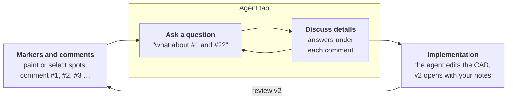

# Third Wheel: communication tool for vibe CADing

Third Wheel is a desktop app where you talk to your AI agent the way you'd talk to a CAD engineer: you **point at the
model**, in a second. No more ten minutes of "the edge on the left, no, the other one" in plain text.

Open a STEP file (the usual file format for exchanging CAD models) and talk to your AI agent, such as Claude Code, in
the app's **Agent** tab. Paint or select the spot you mean and write a comment. The agent reads exactly which faces
(surfaces of the part) and edges you marked. Ask a question about the spot, and the answer appears under your comment.
Ask for a change, and the agent edits the CAD. The next version opens with your notes carried over.

![Demo: in the Agent tab you ask Claude Code for the Square Wheel cube, and it opens. You paint an antenna with the Brush and comment #1: "Will they print?" You select the hole the wheel's pin sits in (labelled Ø5.1 mm) and comment #2. You ask "What do you think of #1 and #2?" The agent answers under each comment: the antennas are fine, the pin is too tight. Under #2 you reply "Yes, make it 0.25 mm". square-wheel_v2 opens with both markers moved over and #2 marked fixed, and you confirm. Asked to make the wheel round, the agent says no: square wheels are the brand.](docs/images/demo.gif)

- **Use it next to your own CAD:** Third Wheel has no CAD inside. It doesn't build or edit parts. Your AI agent does
  that in your own CAD and exports a STEP file. That CAD can be an app the agent drives through scripting or MCP
  (Fusion, FreeCAD, SolidWorks), or CadQuery / build123d code the agent writes. Third Wheel is where you look at the
  part and point at what you mean.
- **STL and 3MF files open too**, with paint and comments only.
- **Runs on macOS and Windows.**
- **Your model file is never changed:** notes are saved next to it.

> [!NOTE]
> **Early version (v0.2).**
>
> - **Today:** Third Wheel is its own window next to your AI agent. You mark and comment on the model here, and the AI
>   answers under each comment. You can talk to the AI in the app's **Agent** tab or in the agent's own window
>   (terminal, VS Code …). Claude Code and other agents that support MCP can connect.
> - **Follow along:** star this repo, or choose **Watch → Custom → Releases** to hear about new versions. I post
>   progress videos on Instagram: [@ximple.printing](https://www.instagram.com/ximple.printing/).

## Download

Get the latest version from **[Releases](https://github.com/XiLaoTr/third-wheel/releases/latest)**:

- **Mac** (Apple Silicon and Intel, macOS 12 or newer): `Third-Wheel-<version>-mac.dmg`. Open it and drag **Third Wheel**
  into **Applications**. Start it from there.
- **Windows 10 / 11**: `Third-Wheel-<version>-win-x64.exe`. Run it and follow the installer.

**The first start shows a warning. That's expected.** The app isn't signed with a paid Apple / Microsoft certificate
yet, so your computer can't tell who made it. You allow it once:

- **Mac:**
  1. "Apple could not verify “Third Wheel”…" appears. Click **Done** (not **Move to Bin**).
  2. Open **System Settings → Privacy & Security**.
  3. Scroll down to "“Third Wheel” was blocked…" and click **Open Anyway**, then **Open Anyway** again.

  macOS 14 or older: right-click the app → **Open** → **Open**.

- **Windows:** "Windows protected your PC" appears. Click **More info** → **Run anyway**.

**Prefer to build it yourself?** [Build from source](docs/development.md#build-from-source) takes about 10 minutes, no
programming. Or let your AI agent do it: ask it to _clone https://github.com/XiLaoTr/third-wheel and build it_, then to
_run Third Wheel_.

## Set up Claude Code

**Once:**

1. In the app, click **AI: no agent yet** (bottom left) or **Set up your AI agent…** on the start page.
2. Click **Add Third Wheel to Claude Code**.

**Each time you work:**

3. In Third Wheel, open your CAD folder with **Open folder…**.
4. Start Claude Code in that folder. The line to copy is in the setup pop-up, under **Chat in Third Wheel**.
5. Copy the start phrase from the **Agent** tab (**Copy**) and paste it into Claude Code. The tab turns green and
   shows **listening**.
6. Ask for what you want in the **Agent** tab, for example:

   > _Make a 40 × 20 mm L-bracket with two M3 holes and open it here._

Your agent builds and changes parts in a CAD it can drive, not in Third Wheel (see **Use it next to your own CAD**
above). Keep the app open while the agent works.

**No button (Claude Code not found)?** The same pop-up has a command for the terminal and a `.mcp.json` file to copy.
See the [user guide](docs/user-guide.md#set-up-claude-code).

### Other agents

Codex, Gemini CLI, Copilot CLI, Cursor, VS Code Copilot, Cline and LM Studio connect the same way (not tested yet):
see [Other AI agents](docs/user-guide.md#other-ai-agents).

- **The ChatGPT app / website can't connect:** it only reaches MCP servers on the internet.
- **Local models** work only through an MCP agent app like LM Studio, not Ollama alone.

## How it works

- **Mark many spots at once.** Paint or select each spot and comment on it: #1, #2, #3 …
- **Small loop in the Agent tab: talk it through.** Ask about your comments ("what about #1 and #2?") and discuss
  the details. The agent answers under each comment or in the chat. A reply under a comment reaches the agent at once.
  No new version is needed. The agent reads your marks as exact CAD faces and edges, with their sizes, so it doesn't
  have to guess from screenshots.
- **Big loop: a new version.** Once you agree on a change, the agent edits the CAD and `part_v2.step` opens. Your
  markers and comments move over, with the agent's answer under each. Review it: click **Confirm** if a fix is right,
  **Reopen** if it isn't, then mark what's next.
- **Want to go through the whole model first?** Comment on every spot, then click **Send review** to send all new
  comments at once.

## Try it on the Square Wheel

Want a model to play with? The [Square Wheel cube](test-models/square-wheel/) is Third Wheel's own test model: the
logo's square wheel as a 30 mm cube, with the round third wheel pinned to its side. It has every kind of face the app
handles (flat faces, holes, cones, spheres, a rounded rim and a wavy top), two bodies (solid pieces) and a second
version.

| File                   | What it's for                                                                                                                                                                         |
| ---------------------- | ------------------------------------------------------------------------------------------------------------------------------------------------------------------------------------- |
| `square-wheel.step`    | The model from the demo above.                                                                                                                                                        |
| `square-wheel_v2.step` | The next version: looser pin, one eye moved up, no smile. Add it as a new version and watch your markers (the spots you marked) move over, or get flagged where the geometry changed. |
| `square-wheel.stl`     | The same model as a mesh, to try mesh-only mode (paint and comments only).                                                                                                            |
| `square_wheel.py`      | For reference only: the [build123d](https://github.com/gumyr/build123d) script that made the three files. You don't need it to try Third Wheel.                                       |

1. Download `square-wheel.step` and `square-wheel_v2.step` into one folder.
2. Open the folder with **Open folder…** and pick `square-wheel.step`, or ask your agent: _"Open square-wheel.step in
   Third Wheel for my review."_
3. Mark a spot and ask about it. For example, select the hole the pin sits in and ask: _"Is there enough play for
   printing?"_
4. Add `square-wheel_v2.step` as a new version: **Add file** → **New version of …**. Your markers move over. This file
   stands in for the next version your agent would export from your CAD.

## Learn more

- **[User guide](docs/user-guide.md):** projects, parts and versions, tools and shortcuts, checking how two parts fit.
- **[Changelog](CHANGELOG.md):** what changed in each version.
- **[Development](docs/development.md):** building, tests, project layout.

## How it was made

Third Wheel was designed by XiLaoTr (the idea, the user experience and the humour) and vibe-coded with
[Claude Code](https://claude.com/claude-code) (Anthropic), which wrote the code. I'm not a programmer. Commits
co-authored by Claude say so in their `Co-Authored-By` line.

## License

Licensed under the [Apache License 2.0](LICENSE). Copyright 2026 XiLaoTr.

Contributions are welcome: see [Contributing](CONTRIBUTING.md) (commits need a sign-off). Found a security problem?
Report it privately: see [Security](SECURITY.md).
